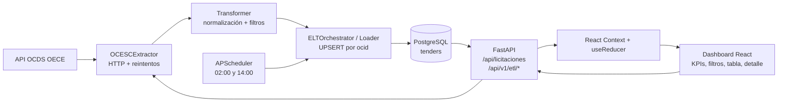

# Arquitectura y flujo

## 1. Resumen ejecutivo

Licitaciones Engine es una solución dividida en dos aplicaciones:

- **Backend:** API FastAPI, pipeline ETL/ELT asíncrono y persistencia en PostgreSQL mediante SQLAlchemy.
- **Frontend:** dashboard React servido por Vite y estilizado con Tailwind CSS.
- **Fuente externa:** API OCDS de Contrataciones Abiertas del OECE.

El backend extrae releases OCDS, normaliza los registros, filtra procesos vigentes y los persiste en la tabla `tenders`. El frontend consulta esos registros mediante HTTP, administra filtros y selección en un store local y presenta una tabla con panel de detalle.

## 2. Mapa conceptual



### Capas

1. **Integración externa:** `backend/src/etl/extractor.py` construye parámetros OCDS, valida HTTP/JSON y reintenta fallos de red.
2. **Transformación:** `backend/src/etl/transformer.py` convierte releases a diccionarios compatibles con el modelo relacional.
3. **Persistencia:** `backend/src/database.py` crea el motor async; `backend/src/models/tenders.py` define `TenderModel`; `loader.py` realiza UPSERT.
4. **API:** `backend/src/api/main.py` consulta PostgreSQL, normaliza campos derivados y expone respuestas listas para el frontend.
5. **Presentación:** `frontend/src/App.jsx` consulta la API; `AppState.jsx` mantiene estado; `selectors.js` filtra y ordena; los componentes renderizan la experiencia.

## 3. Flujo end-to-end

### 3.1 Ingesta y almacenamiento

1. `APScheduler` inicia dentro del lifespan de FastAPI y agenda dos ejecuciones diarias, a las 02:00 y 14:00.
2. `ELTOrchestrator.run_pipeline()` solicita una o más páginas a `OCESCExtractor.fetch_tenders()`.
3. El extractor transforma categorías en español a `goods`, `works` o `services`, agrega fechas y pagina con `page`.
4. El transformer lee `ocid`, `tender`, `items`, `value` y fechas OCDS. Determina `Vigente` si el ítem está `active`, si `statusDetails` es `CONVOCADO`/`VIGENTE`, o si el release contiene el tag `tender`.
5. Los registros que pasan el filtro se cargan en PostgreSQL con `INSERT ... ON CONFLICT DO UPDATE` usando `ocid` como clave.
6. El payload OCDS original se conserva en `raw_payload` para auditoría y derivación de entidad, región, documentos y fecha límite.

### 3.2 Consulta desde React

1. Al montar `App`, un `useEffect` construye `GET /api/licitaciones`.
2. Los parámetros enviados son `vigentes`, `tipo`, `fecha` y `search`, derivados de filtros y texto de búsqueda.
3. FastAPI aplica filtros SQL sobre `TenderModel` y ordena por `fecha_lanzamiento` descendente.
4. La API transforma cada fila al contrato visual: `codigo_seace`, `entidad`, `tipo_objeto`, `valor_estimado`, `hitos`, `documentos`, `match_score` y otros campos.
5. `SET_CONVOCATORIAS` guarda la respuesta en el reducer. `selectVisible()` aplica filtros locales adicionales y ordena por coincidencia, valor o plazo.
6. `KpiRow`, `FilterBar`, `BiddingTable` y `DetailPanel` consumen el estado mediante `useApp()` y selectores.

### 3.3 API disponible

| Método | Ruta | Función |
|---|---|---|
| GET | `/api/v1/health` | Comprueba que el backend responde y que puede consultar `tenders`. |
| GET | `/api/licitaciones` | Devuelve procesos filtrados y normalizados para React. |
| GET | `/api/v1/etl/config-options` | Devuelve objetos, estados y rangos de fecha disponibles. |
| GET | `/api/v1/etl/status` | Devuelve el último estado ETL almacenado en memoria. |
| POST | `/api/v1/etl/trigger` | Ejecuta o encola un ETL; `sync=true` lo ejecuta en la petición. |

No se observan routers separados: las rutas están concentradas en `backend/src/api/main.py`.

### 3.4 Autenticación y autorización

No existe flujo de autenticación. No hay usuarios, sesiones, JWT, OAuth, API keys, dependencias de autorización ni rutas protegidas. Por tanto, el endpoint de consulta y el disparo del ETL quedan accesibles a cualquier cliente que alcance el servidor. La configuración CORS incluye `*` junto con `allow_credentials=True`, combinación que debe restringirse antes de un despliegue real.

### 3.5 Estado y errores

- **Backend:** `ultimo_estado_etl` es un diccionario global en memoria con `idle`, `running`, `completed` o `failed`; se pierde al reiniciar y no modela ejecuciones concurrentes.
- **Frontend:** `useReducer` gestiona carga, error, vista, filtros, orden, navegación móvil y registro seleccionado.
- **Errores HTTP:** el frontend lanza un error genérico cuando `fetch` recibe una respuesta no exitosa. No hay esquema de error compartido ni reintento/caché de consultas.
- **ETL:** el orquestador detiene la paginación cuando una página falla y devuelve un resultado parcial; la estrategia debe hacerse explícita para operación productiva.

## 4. Stack tecnológico

### Backend

- Python `>=3.10`, FastAPI y Uvicorn.
- SQLAlchemy `>=2.0` con `asyncpg`; `psycopg2-binary` está declarado para compatibilidad con PostgreSQL.
- Pydantic/Pydantic Settings para configuración y el request `ETLConfigRequest`.
- HTTPX y Tenacity para consumo externo y reintentos exponenciales.
- APScheduler para trabajos programados.
- Pytest y `pytest-asyncio`, aunque la cobertura actual es mínima.
- Ruff configurado con longitud de línea 88 y objetivo Python 3.11.

### Frontend

- React `18.3.1` y ReactDOM.
- Vite `5.4.11`, plugin React, servidor en el puerto `8080`.
- Tailwind CSS, PostCSS y Autoprefixer.
- No hay librería de gráficos, cliente de caché, autenticación ni framework de pruebas frontend declarado.

## 5. Ejecución local

```bash
cd backend
uvicorn src.api.main:app --reload --port 8000
```

```bash
cd frontend
npm install
npm run dev
```

El frontend usa `VITE_API_URL` si está definido; si no, usa `http://localhost:8000`. La conexión de base de datos se configura con `DATABASE_URL` y la API OECE con `API_URL`.

## Oportunidades de Mejora / Deuda Técnica

- Implementar Alembic: no existen revisiones funcionales y `alembic/env.py` es un placeholder.
- Retirar credenciales por defecto y cualquier secreto versionado; validar configuración al iniciar.
- Incorporar autenticación, autorización por endpoint y protección específica para `POST /api/v1/etl/trigger`.
- Restringir CORS a orígenes conocidos y revisar el uso de credenciales.
- Separar routers, esquemas de respuesta y servicios de la aplicación monolítica `api/main.py`.
- Añadir paginación, límites de consulta y esquemas Pydantic para `/api/licitaciones`.
- Persistir historial/estado de ejecuciones ETL, evitar solapamientos y elegir un único scheduler.
- Sustituir `print` por logging estructurado, métricas y trazas con contexto de ejecución.
- Completar modelos de entidades, esquemas OCDS y `notifier.py`, que actualmente son stubs.
- Reemplazar `match_score` calculado como `85 + (idx % 14)` por una métrica real y auditable; distinguir datos derivados de datos fuente.
- Evitar hitos y documentos ficticios cuando OCDS no aporta esos datos; exponer su procedencia y nivel de confianza.
- Unificar filtros backend/frontend y corregir la semántica de `vigentes=false`, que actualmente significa “todo lo que no contiene Vigente”.
- Añadir pruebas unitarias deterministas para extractor, transformer, loader, API y selectores; la prueba actual hace una llamada de red sin aserciones fiables.
- Sincronizar README y documentación heredada con el flujo API actual, que ya no depende de `mockData.json`.